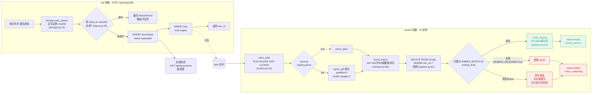
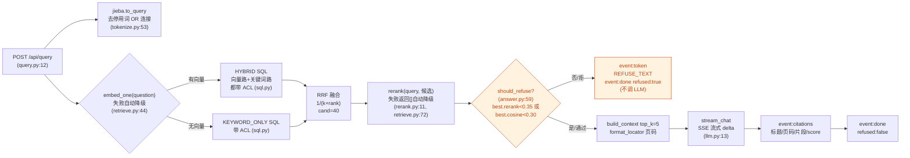

# kb-deskpet 架构分析报告

> 架构评审 · 仅评审不改码
> 仓库：`/Users/apple/kb-deskpet` ｜ 评审对象：`server/` 侧 P0 文本闭环
> 生成日期：2026-11-06 ｜ 评审人：Gao · 架构师

---

## TL;DR

**一句话定位**：一套"单机可跑、零中间件"的内部 RAG 知识库——PDF/TXT/MD/CSV 上传，经 `jieba 预分词 + 向量 + 关键词 → RRF 融合 → 重排` 混合检索，命中不足就**确定性拒答**，命中则带页码引用由 LLM 流式生成；向量/重排在本地 `embed` 容器内完成，只有生成模型出网。

**成熟度判断**：**生产可用的 P0 最小闭环，工程纪律非常强，但"闭环"不等于"完整"**。
- 强项：8 条铁律基本全部落地；外部依赖被严格收敛在 `services/` 一层，可整体换供应商；降级矩阵覆盖完整；文档（10~16）齐全且与代码一致度高。
- 短板：权限是"单部门 + 显式 acl"的粗粒度模型，`GET /api/documents/{id}` 越权未修；`audit_logs`/`role` 是**预留未实现**；worker 无作业超时回收（崩溃即卡死 `running`）；拒答阈值 `0.35` 未用真实数据重标定（最高优先债）；数据实况仅 1 条，任何"效果"结论都不成立。

**结论**：架构清晰、边界清晰、铁律守得住，**可直接作为 P0 验收基线进入下一步**；但上生产/接真实文档前，必须偿还"阈值重标定 + 文档详情越权 + worker 超时回收 + 审计"四项债（见第九节）。

---

## 一、系统分层与模块职责

> 原则（来自 `docs/12` 核心原则）：**"能用 30 行 SQL 解决的，不引入一个中间件。"** 分层严格，依赖方向单向 `api → search/ingest → services → 外部`。

| 层 | 职责 | 关键文件 | 约束（不许做什么） |
|---|---|---|---|
| **入口 / 装配** | FastAPI 装配、连接池生命周期、静态验收台 | `app/main.py` | 不放业务逻辑 |
| **鉴权** | Bearer → `CurrentUser(uid, dept, role)` | `app/deps.py` | 不做权限过滤（过滤在 SQL） |
| **API 层** | 收文件/文本、算 sha256、建 doc+job；检索转发；SSE；健康/列表 | `app/api/ingest.py` `app/api/query.py` `app/api/meta.py` | 不拼 SQL、不做解析 |
| **入库层（Worker 侧）** | 解析→切片→向量化→写库 的状态机 | `app/ingest/pipeline.py`、`chunker.py`、`parsers/{pdf,registry}.py` | 不切块（chunker 负责）、不抢任务 |
| **检索层** | jieba 分词 / 唯一 ACL+混合 SQL / 双路 RRF+重排 / 拒答闸门 | `app/search/{tokenize,sql,retrieve,answer}.py` | ACL 只此一处；检索不改顺序 |
| **服务层（外部依赖收敛）** | embedding / rerank / llm / storage 的协议适配 | `app/services/{embedding,rerank,llm,storage}.py` | 不感知业务语义；换供应商只改这一层 |
| **基础设施** | 连接池/事务、配置 | `app/db.py` `app/config.py` | — |
| **队列 Worker** | 单进程 2s 轮询 `claim_job()`，吞掉一切异常 | `app/worker.py` | 不并发处理同一 doc |
| **本地模型服务（独立容器）** | fastembed+onnxruntime 加载 jina 模型，暴露 OpenAI 兼容 `/v1/embeddings` `/v1/rerank` | `embed_service/app.py` | 不做鉴权（仅绑回环 127.0.0.1:8090） |
| **运维脚本** | 迁移、造账号、M0 自检 | `scripts/{migrate,seed,check_keys}.py` | — |
| **数据库 Schema** | 9 张表 + 局部索引 + `claim_job()` | `migrations/0001_init.sql` `0002_claim_job_setof.sql` | 维度 1024 锁死 |

**容器拓扑**（`docker-compose.yml`）：`postgres`(pgvector) / `api` / `embed` / `worker`，三条数据通路——api↔postgres（psycopg3 池，读写带 ACL）、api/worker↔embed（本地回环 HTTP）、api↔Agnes LLM（唯一出网 HTTPS）。

---

## 二、核心数据流

### 2.1 入库流水线（上传 → 解析 → 切块 → 向量化 → 入库）



**状态机**：`uploaded → parsing → chunking → embedding → ready | failed`，单调向前，失败必须落 `error_code`。

### 2.2 检索流水线（查询 → 分词 → 混合检索 → 重排 → 拒答闸门 → LLM 生成）



**关键设计**：闸门在**生成之前**（确定性代码判断，不让模型自由发挥"有没有"）；`/api/search` 与 `/api/query` **共用 `retrieve()`**，保证评测分数 = 线上分数。

---

## 三、数据库 Schema 概览

9 张表（7 业务 + 2 支撑）。ER 关系：

```mermaid
erDiagram
    DEPARTMENTS ||--o{ USERS : "1:N"
    DEPARTMENTS ||--o{ DOCUMENTS : "归属"
    USERS ||--o{ DOCUMENTS : "owner"
    DOCUMENTS ||--o{ CHUNKS : "1:N (CASCADE)"
    DOCUMENTS ||--o{ ACL : "1:N (CASCADE)"
    DOCUMENTS ||--o{ JOBS : "1:N (CASCADE)"

    DEPARTMENTS { uuid id PK; text name UQ; uuid parent_id FK }
    USERS { uuid id PK; text email UQ; text api_token UQ; uuid dept_id FK; text role }
    DOCUMENTS { uuid id PK; text title; uuid dept_id; uuid owner_id; text status; text sha256; text visibility; jsonb ext; int chunk_count; text error_code }
    CHUNKS { uuid id PK; uuid doc_id FK; uuid dept_id; int seq; text text; jsonb locator; vector(1024) embedding; text embed_model; tsvector tsv; "UNIQUE(doc_id,seq)" }
    ACL { uuid doc_id; text subject_type; uuid subject_id; text permission; "PK(doc_id,subject_type,subject_id)" }
    JOBS { uuid id PK; uuid doc_id FK; text status; int attempts; timestamptz locked_at }

    DEPARTMENTS { }
```

关键约束与索引：
- `documents.UNIQUE(dept_id, sha256)`：同部门同内容去重（`ingest.py:45` 查、DB 约束兜底）。
- `chunks.UNIQUE(doc_id, seq)`：入库幂等兜底。
- `chunks.embedding vector(1024)`：**维度锁死在 DDL**（`0001_init.sql:64`）。
- `idx_chunks_hnsw`（`m=16, ef_construction=64`，余弦）/ `idx_chunks_tsv`（GIN）/ `idx_jobs_claim`（局部索引 `WHERE status='queued'`）。
- `claim_job()`：`FOR UPDATE SKIP LOCKED` 原子抢占；**`0002` 已修为 `RETURNS SETOF`**，避免空队列返回"一行全 NULL"导致 worker 把 `doc_id='None'` 当真任务 2s 自旋崩溃。

---

## 四、八条铁律逐条对照检查表

> 状态：✅ 合规 ｜ ⚠️ 合规但有缺口 ｜ ❌ 违规
> 行号基于当前 HEAD（`d840831`）源码。

| # | 铁律 | 代码对应位置 | 结论 |
|---|---|---|---|
| 1 | **权限只能写在 SQL 里**，任何 `SELECT FROM chunks` 必带 `ACL`，禁止先查后过滤 | `search/sql.py:8` 唯一定义 `ACL`；三处注入 `HYBRID` 向量路(L34)、`HYBRID` 关键词路(L45)、`KEYWORD_ONLY`(L74)；`retrieve.py:52` 按 `emb` 二选一、`sql.py` 内 `LIMIT` 在 ACL 之后。ACL 常量**全系统仅一处**（`grep -n ACL` 仅 `sql.py:34/45/74` 命中） | ✅ |
| 2 | **维度锁死 1024** | DDL `0001_init.sql:64` `vector(1024)`；运行时双向校验：`embed_service/app.py:35` `REQUIRED_DIM=1024` + `:71` 加载后实测维度不符即弃用；`services/embedding.py:46` 入库前再校验 `len(v)!=embed_dim` 即抛错；`check_keys.py:58` M0 自检强制 1024 | ✅ |
| 3 | **每个 chunk 的 `locator` 不能为空** | `chunker.py:54/61/69/86` 每个 `Chunk` 都带 `dict(locator)`（PDF=`{"page":n}`，文本=`{"offset":0}`，视频逻辑预留）；写入 `pipeline.py:51` `json.dumps(c.locator)`；DDL `0001_init.sql:62` `locator jsonb NOT NULL DEFAULT '{}'` | ✅ |
| 4 | **检索不到就拒答**，闸门在 `should_refuse` | `answer.py:59` `should_refuse()`；`answer.py:79` 在**生成前**调用，命中即吐 `REFUSE_TEXT` 且**不调 LLM**（`:83` 直接 return）；阈值 `settings.not_found_threshold=0.35`（`answer.py:64`）/ 余弦 0.30（`:67`） | ⚠️ 机制合规，但**阈值 0.35 未经真实数据重标定**（README 明示"接入真实文档后必须重标定"，当前 1 条数据无法标定）——生产前最高优先 |
| 5 | **重排必须可降级**，`rerank.py` 返回空列表时链路照常 | `rerank.py:11` 返回 `[]`（未配 key / 无文档 / 5xx / 异常）；`embed_service/app.py:160` rerank 模型加载失败返回 501（非 500）；`retrieve.py:71-78` `if scored:` 为空则不重排、保持原序、`hits.sort` 按 rerank 缺失→0 稳定排序，主链路不中断 | ✅ |
| 6 | **中间产物即时删** | `ingest.py:41` 超限即 `storage.delete`；`ingest.py:50` 去重命中删已落盘文件；`storage.py:49` `delete` 容错（删失败只 log 不让请求失败）。⚠️ 注：视频音轨/分段/截图 P0 未实现（P0 只有 pdf/txt/md/csv），故本条目前主要覆盖"上传临时文件" | ✅（P0 范围） |
| 7 | **入库幂等**，先 `DELETE FROM chunks WHERE doc_id=?` 再写，`UNIQUE(doc_id,seq)` 兜底 | `pipeline.py:91` 主路径先删后写；`pipeline.py:112` 降级路径重删；`pipeline.py:42` `ON CONFLICT (doc_id, seq) DO UPDATE`；DDL `0001_init.sql:67` 唯一约束 | ✅ |
| 8 | **不加没被要求的抽象** | `parsers/registry.py` 是**纯字典分派**（`PARSERS={...}` 3 行 + `parse()`），**无 `BaseParser`/`AbstractStore` 抽象类**；`storage.py` 函数式；全文无工厂/策略抽象 | ✅ |

**铁律总体：8/8 无 ❌，其中 4 条标 ⚠️（机制对但生产前需补动作）**。

---

## 五、常见坑对照（AGENTS.md "四、常见坑"）

| AGENTS.md 列的坑 | 代码是否规避 | 证据（文件:行） | 结论 |
|---|---|---|---|
| `pypdfium2` 不用 PyMuPDF（AGPL 传染） | 是 | `parsers/pdf.py:9` `import pypdfium2`；`pyproject.toml` 依赖 `pypdfium2>=4.30`，**无 PyMuPDF** | ✅ |
| pgvector HNSW 建表后再建（空表建反而慢）；`ef_search` 默认 40 会话级调 | **未规避** | `0001_init.sql:72` `CREATE INDEX idx_chunks_hnsw` **写在 0001 建表同批**（空表上建），与 AGENTS.md"建表后再建"建议相悖；`ef_search` 用 PG 默认（40），检索 SQL **无会话级 `SET LOCAL ... ef_search`** 调优点 | ⚠️ 小影响（单机十万级够用），建议数据量大后把 HNSW 建表挪到 seed 之后、补 ef_search 调优 |
| 上传边写边算 sha256，别读两遍 | 是 | `storage.py:24 save_stream` 单遍循环里同时 `h.update(buf)`+`f.write(buf)`；`sha256_of`（读已有文件）是**独立工具**非上传路径 | ✅ |
| SSE 必须设 `X-Accel-Buffering: no` | 是 | `query.py:25` `headers={"Cache-Control":"no-cache","X-Accel-Buffering":"no"}` | ✅ |
| Dify 那 15 个容器无关，别塞 compose | 是 | `docker-compose.yml` 仅 4 服务（postgres/api/embed/worker），无 Dify | ✅ |
| （三、中文检索）两处都必须走 `tokenize.py`、查询 OR 连接 | 是 | 入库 `pipeline.py:55` `to_tsv_text`；查询 `retrieve.py:36` `to_query`，**都 import `app/search/tokenize`**；`tokenize.py:68` 查询用 `" | ".join`（OR），`:39` 入库默认**不**去停用词（对称） | ✅ |

**常见坑：5/5 全部规避；唯一 ⚠️ 是 HNSW 建表时机**（属"可接受、量大再调"，非阻断）。

---

## 六、风险点与改进建议（只标注，不修复）

> 按"阻断生产"→"技术债"→"代码坏味道"分级。

### 🚨 生产阻断级（上真实文档前必须处理）

1. **拒答阈值未重标定（最高优先）** — `answer.py:64` `not_found_threshold=0.35` 是拍脑袋值，`embed_service/app.py:170` 把 bge logits 做了 sigmoid 对齐到 0~1，但 0.35 这条线从未用真实语料标定过。过松→拒答漏（编答案），过紧→误拒。当前数据实况仅 1 条（`docs/05` §八），**任何召回/拒答结论都不成立**。建议：接真实文档后跑 `eval/`（当前 8 题，验收要求 30 题）+ 人工标定再上线。
2. **`GET /api/documents/{doc_id}` 越权未修** — `meta.py:52` 直接 `SELECT ... WHERE id=%s`，**不带 ACL/可见性谓词**。知道 doc_id 即可读元信息（不含正文）。与铁律 1 精神冲突。建议：加 `visibility/owner/dept/acl` 同 ACL 判定，或至少 `owner_id=%s OR dept_id=%s`。
3. **worker 无作业超时回收** — `worker.py` 崩溃后作业永久卡 `running`（`docs/12` §八自认"已知缺口"）。建议：加 `locked_at` 超时回收（`UPDATE ... WHERE status='running' AND locked_at < now() - interval` 回 `queued`），或 supervisor 重启 + 定期扫描。
4. **`audit_logs` 表建了从未写入** — `0001_init.sql:91` 有表，但全代码 `grep` 无 `INSERT INTO audit_logs`。无法追溯"谁传了什么/谁问过什么"。合规要求一出现即阻断。
5. **`role` 字段无实际鉴权作用** — `users.role ∈ {member,editor,admin}`，但任何登录用户都能上传/提问（`ingest.py` 无 role 判断）。若需"只有 editor 能传"，路由层完全缺失。

### ⚠️ 技术债（量上来后再还）

6. **单 worker + 无重试退避** — `worker.py:3` 注释自认"WORKER_CONCURRENCY 故意 1"；`run_after` 支持延迟但**失败后不自动重试**（`docs/12` §八"现在做是过度设计"）。批量入库 >200 篇/日会排队。
7. **无迁移回滚脚本** — `migrate.py` 只能向前（`docs/12` §十二自认）。生产第一次改 schema 即需补 down 迁移。
8. **内网明文无 TLS** — `docs/12` §九，跨网段访问前需前置 nginx+证书（SSE 的 `X-Accel-Buffering` 也暗示了 nginx 场景，但仓库里**没有** nginx/反代配置）。
9. **多部门层级未支持** — `departments.parent_id` 预留但 ACL 把 `dept` 语义写死为"等于"（`sql.py:12`），树形组织需改 SQL。
10. **`EMBED_REQUIRED=false` 联调模式会静默关拒答闸门** — `pipeline.py:113` 降级入库后 `embed_model='none'`、`cosine=None`，`answer.py:67` 该分支落到 `best.cosine is not None` 为 False→`should_refuse` 返回 False→**不拒答直接生成**。仅联调用，生产必须 `true`（README 已警示，但缺启动期自检拦截）。
11. **`/v1/rerank` 501 的降级是"静默"的** — `embed_service/app.py:160` 加载失败返回 501，调用方降级无告警通道（仅 log.warning）。生产环境 rerank 长期 501 而无人知。

### 💀 代码坏味道 / 潜在 bug 信号

12. **`__import__("json")` 丑写法** — `ingest.py:86` 函数体内 `__import__("json").dumps(...)`，应顶部 `import json`。
13. **`_set_status` 动态 SQL 字符串拼接** — `pipeline.py:23-26` 用 f-string 拼 `SET a=%s, b=%s`，字段名来自**内部**调用（非用户输入）故当前安全，但绕过 SQL 审查，与"SQL 集中可审"的设计目标略冲突；建议改 `UPDATE ... SET %(k1)s...` 显式模板。
14. **`get_conn` 每次 `open_pool()` 幂等重复调用** — `db.py:32` `get_conn` 内又调 `open_pool()`，而 pool 已是模块级单例；无害但冗余（`open` 后 `pool.closed` 为 False 走短路）。
15. **`pool.max_size=8` vs embed `OMP_NUM_THREADS=4` 单实例锁** — `db.py:15` 连接池 8，但 `embed_service/app.py:137/165` 模型推理被 `_lock` **全局串行化**（ONNX 单实例）。高并发问答时 rerank/embed 是硬串行瓶颈，吞吐上限低。单机可接受，规模化需评估多实例。
16. **`retrieval` SSE 事件在拒答时也先发** — `answer.py:77` 先吐 `event:retrieval` 再判闸门，前端需容错"有检索结果但仍拒答"（cosine<0.30/rerank<0.35 但 hits 非空）。属设计如此，前端契约需文档化。
17. **`chunks.dept_id` 冗余自 documents 无外键** — `0001_init.sql:59` `dept_id uuid NOT NULL` 无 FK 约束，靠 pipeline 写时保证一致；若 documents.dept 变更不联动会脏。
18. **`embed_dim` 仅 env 可配但 DDL 硬编码 1024** — `config.py:20` `embed_dim=1024` 可被 env 改，但 DDL `vector(1024)` 不随之变；若误设 `EMBED_DIM=768`，`embedding.py:46` 会全量抛错（好），但**不会自动改 DDL**。属"配置与 DDL 脱钩"的隐患，文档已说明需手工改。
19. **`check_keys.py` 的 LLM 检查是 `stream:False`，而线上是流式** — `check_keys.py:94` 非流式测通≠流式一定通（极少见但存在）。

---

## 七、架构亮点（值得保留/复制）

- **外部依赖单点收敛**：`services/` 一层包住 embedding/rerank/llm/storage，"换供应商只改这一个目录"（`docs/12` §三依赖方向铁律）。
- **本地 embed 容器 + 双向维度校验**：`embed_service/app.py` 加载前查支持列表、加载后实测维度、入库前再校验、M0 自检再校验——**四道闸**确保"绝不静默换维度"。
- **幂等设计到位**：`UNIQUE(doc_id,seq)` + `ON CONFLICT DO UPDATE` + 先删后写，重跑同一 doc 幂等。
- **降级矩阵成文**：`docs/12` §八逐条列故障→用户看到什么→系统行为→数据影响，工程纪律好。
- **文档包极完整**：`docs/` 10~16 覆盖需求/规划/设计/实施/测试/复盘，与代码一致度高，可移交性强。

---

## 八、与既有文档的一致性核对

| 项 | 文档说法 | 代码事实 | 一致 |
|---|---|---|---|
| 容器数 | 4（docs/12 §二） | `docker-compose.yml` 4 服务 | ✅ |
| 表数 | 9（docs/05） | `0001` 7 业务 + `schema_migrations`(在 migrate.py) + `audit_logs` | ✅ |
| 维度 1024 | 锁死（AGENTS.md/05） | DDL + 4 道运行时校验 | ✅ |
| 去重 sha256 | `UNIQUE(dept_id,sha256)` | `ingest.py:45` 查 + DDL 约束 | ✅ |
| 状态机 | uploaded→…→ready/failed | `pipeline.py` 逐态推进 | ✅ |
| "当前数据 1 条" | docs/05 §八 | 属实（文档自认） | ✅ |

一致性高，未发现文档与代码矛盾（仅 `docs/05` §八"1 条数据"是**数据面**实况，非代码 bug）。

---

## 九、给主理人的一句话结论 + 行动项

**架构可验收为 P0 基线**。上生产 / 接真实文档前，**必须**偿还（优先级从高到低）：

1. 🔴 拒答阈值 0.35 用真实语料重标定 + 扩 `eval/` 到 30 题再放行（`answer.py:64`）
2. 🔴 `GET /api/documents/{id}` 补 ACL（`meta.py:52`）
3. 🔴 worker 加 `running` 超时回收（`worker.py`）
4. 🟠 `audit_logs` 接入写入（上传/问答）
5. 🟠 `role` 实际鉴权语义定义或暂时废弃该字段
6. 🟡 `EMBED_REQUIRED=false` 加启动自检拦截，防生产误配
7. 🟡 HNSW 建表时机 / ef_search 调优（量大后）
