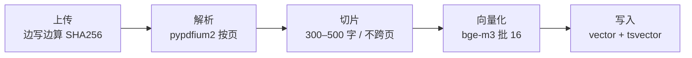
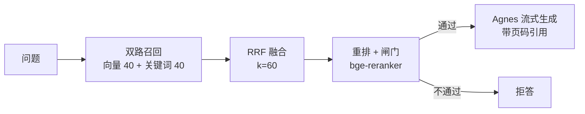

# 进度与技术说明

> 汇报对象：项目相关方（非技术同学看第一、六、七章即可）
> 记录时间：2026-10-30
> 对应代码：`kb-deskpet` @ `5024d44`（42 个文件，约 1900 行）
> 配套文档：`~/WorkBuddy/本地部署dify/公司内部知识库_桌宠方案v1.md`（做什么）、`公司内部知识库_实施计划与落地方案.md`（怎么做）

---

## 一、三条线的真实进度

| 项目线 | 进度 | 硬指标 | 卡点 |
|---|---|---|---|
| **Dify 本地部署** | 部署 100%，**使用 0** | 15 容器 running，端到端验证通过；`apps=1`、`datasets=0` | 没有业务跑在上面；Docker 未开机自启，机器重启即失联 |
| **校园平台**（`Documents/New project`） | 方案 670 行，**代码 0 commit** | 仍 176 行单文件，`docs/archive` 未建 | 未开工 |
| **知识库 P0**（本仓库） | 骨架完成，可运行 | 42 文件 / 约 1900 行，7 个接口全绿 | 缺 embedding key |

知识库是唯一从"方案"推进到"代码"的一条线，下面重点讲它。

---

## 二、技术全景

| 层 | 技术 | 版本 / 关键参数 |
|---|---|---|
| 存储 | PostgreSQL + pgvector | 16 / `pgvector/pgvector:pg16`，`vector(1024)`，HNSW `m=16, ef_construction=64` |
| 全文检索 | PostgreSQL `tsvector` + `ts_rank_cd` | `simple` 配置 + Python 侧 jieba 预分词 |
| 中文处理 | jieba | HMM 模式，去停用词，入库与查询共用同一套规则 |
| 文档解析 | pypdfium2 | 按页抽取，输出 `{"page": n}` 定位（避开 PyMuPDF 的 AGPL） |
| 后端 | FastAPI + uvicorn | 3 个路由模块，SSE 流式输出 |
| 数据访问 | psycopg3 + ConnectionPool | **不用 ORM**，权限谓词与向量打分全部手写 SQL |
| 配置 | pydantic-settings | `.env` 单入口，换供应商只改 4 行 |
| 向量化 | bge-m3（走 API） | 1024 维，批 16，失败重试 3 次 |
| 重排 | bge-reranker-v2-m3（走 API） | 失败返回空列表 → 自动降级 |
| 生成 | Agnes `agnes-3.0-flash` | OpenAI 兼容，SSE 流式 |
| 融合 | RRF 倒数排名融合 | `k=60`，双路各取 40 候选 |
| 队列 | `jobs` 表 + `FOR UPDATE SKIP LOCKED` | 单 worker 轮询 2s，不引入 Redis / Celery |
| 部署 | Docker Compose 3 容器 | postgres(healthcheck, shm 1gb) / api / worker |
| 迁移 | 纯 SQL + `schema_migrations` | 幂等，`make up` 时自动执行 |

**一句话选型逻辑**：P0 只解决"文本闭环"，所以凡是能用一个 Postgres 解决的（向量、全文、队列、权限）都不引入外部组件。少一个组件，就少一处半夜会挂的东西。

---

## 三、入库链路（写侧）



### 3.1 上传

`POST /api/ingest/file`（`app/api/ingest.py`）

- 落盘时**边写边算 sha256**，不把文件读两遍。
- 去重键是 `UNIQUE(dept_id, sha256)`：同部门重复上传直接返回原 `doc_id`，不重复付向量化的钱；跨部门允许各存一份（权限不同）。
- 体积上限 `MAX_UPLOAD_MB`（默认 200），超限删临时文件并返回 413。

### 3.2 解析

`app/ingest/parsers/`（`registry.py` 按后缀分派，`pdf.py` 用 pypdfium2）

- PDF 逐页 `get_textpage().get_text_range()`，**每页单独成一个 block 并带上页码**。
- 这一步决定了后面引用能不能精确到页——没有页码的引用等于没有引用。
- 用 pypdfium2 而不是 PyMuPDF：后者是 AGPL，商用有传染风险。

### 3.3 切片

`app/ingest/chunker.py`

三条硬规则（改任何一条都要重跑 `eval/questions.yaml` 对比）：

1. **不跨页 / 不跨时间戳合并** —— 保证引用页码永远准确。
2. **一个切片 300–500 字**，超长段落先按 `。！？；` 切句再打包，**句内绝不切**。
3. **同页相邻切片留 80 字重叠**，避免答案被切断在边界。

### 3.4 向量化

`app/services/embedding.py`

- 进模型的文本是 `文档标题\n切片正文`，用标题补足切片丢掉的上下文。
- 批 16 调 `/v1/embeddings`；返回维度 ≠ 1024 直接抛错，**不让脏数据进库**（维度错了要重建整张表，早失败比晚发现便宜）。

### 3.5 写入

`app/ingest/pipeline.py`

- 一条 `INSERT ... SELECT dept_id FROM documents`，同时写 `embedding::vector` 和 `to_tsvector('simple', jieba 切好的文本)`。
- 靠 `UNIQUE(doc_id, seq)` + 先 `DELETE` 再写，保证重跑幂等。
- 状态机：`uploaded → parsing → chunking → embedding → ready / failed`，前端轮询 `status` 就能画进度条；失败时 `error_code` + `error_msg` 落在文档行上。

---

## 四、检索链路（读侧）



### 4.1 双路召回

`app/search/sql.py` + `retrieve.py`

- 向量路：`ORDER BY embedding <=> %(emb)s::vector LIMIT 40`。
- 关键词路：`to_tsquery` 命中的按 `ts_rank_cd` 排序取 40。
- **为什么要两路**：语义相近但用词不同的靠向量，专有名词（工号、型号、制度编号）靠关键词，缺一路就有一类问题答不上来。

### 4.2 权限必须在 SQL 里

`sql.py` 的 `ACL` 常量，四选一：

```sql
d.visibility = 'company'
OR d.owner_id = %(uid)s
OR (d.visibility = 'dept' AND c.dept_id = %(dept)s)
OR EXISTS (SELECT 1 FROM acl a WHERE a.doc_id = c.doc_id AND ...)
```

**禁止"先查出来再在 Python 里过滤"**：一次 `LIMIT 40` 可能把别人的 40 条全取回来，前端稍一改动就漏。这条写进了 `AGENTS.md`。

### 4.3 RRF 融合

- `score = Σ 1/(k + rank)`，`k=60`。
- 好处是不需要把余弦相似度和 `ts_rank_cd` 这两个量纲不同的分数"凑"到同一个尺度，只比较名次。

### 4.4 重排

`app/services/rerank.py`

- 把融合后的候选丢给 `bge-reranker-v2-m3`，拿 `relevance_score` 重排序。
- 它挂了、超时了、没配 key —— 一律返回空列表，链路继续用 RRF 分数走完。**检索质量可以降，但问答不能因此失败。**

### 4.5 拒答闸门

`app/search/answer.py::should_refuse()`

- 没有命中 → 拒答。
- 最高分低于 `NOT_FOUND_THRESHOLD`（默认 0.35）→ 拒答。
- 拒答文案固定："知识库里没有查到相关内容。可以换个说法再问，或者把这部分资料先传上来。"
- **绝不把"没检索到"交给模型自由发挥** —— 这是内部知识库最大的一条信任线。

### 4.6 生成与引用

`app/services/llm.py` + `answer.py`

- 上下文按 `[1] 《标题》 第 N 页 + 正文` 拼接，系统提示里写死五条：资料没有就说没有、结论标注编号、矛盾时并列、不复述问题、数字日期逐字照抄。
- 流式吐字，最后单独发 `citations` 事件带回页码。

SSE 事件序列：`retrieval`（命中数 / 最高分）→ `token`（增量文本）→ `citations` → `done`。前端只认这四种事件，不需要理解后端。

---

## 五、支撑性技术（容易被忽略但决定成败）

| 技术 | 怎么起作用 | 不做会怎样 |
|---|---|---|
| **jieba 预分词** | 入库与查询两处都先切词再交给 Postgres；`simple` 配置对中文等于不切词 | 只改一边，检索会**静默归零**：不报错、只是查不出东西 |
| **`FOR UPDATE SKIP LOCKED`** | 一个 SQL 函数 `claim_job()` 完成抢占，多 worker 不抢同一任务 | 就得引入 Redis / Celery，多一个组件多一处故障 |
| **Bearer token 鉴权** | `users.api_token` 一列搞定 P0；接 SSO 时置空该列即可，路由不用改 | 一开始就做 SSO 会拖慢 P0 |
| **幂等 SQL 迁移** | `IF NOT EXISTS` + `schema_migrations` 表，重复执行安全 | 部署脚本得人工判断"跑没跑过" |
| **`AGENTS.md` 八条铁律** | 把权限、维度、引用、拒答这些不能错的点钉死 | 后面接手的人（或 AI）改坏一次，就是一次数据泄漏 |
| **单页验收台** | `app/static/index.html`，拖文件 → 提问 → 看引用，直接调 SSE | 每次验收都要写 curl，没法给非技术同学演示 |

---

## 六、验证到哪一步了

### 6.1 已经真跑通的（不是纸面推演）

| 验证项 | 方法 | 结果 |
|---|---|---|
| DDL 建表 | 在 `pgvector/pgvector:pg16` 容器执行 `0001_init.sql` | ✅ pgvector + HNSW 建成功 |
| 中文 PDF 解析 | Chrome 生成中文 PDF 后解析 | ✅ 文本抽取正确，`{"page":1}` 准确 |
| 切片 | 同一份 PDF 跑 `chunk_blocks` | ✅ 112 字单块，未丢内容 |
| 入库流水线 | 临时替换 embedding 为假向量，跑完整 `ingest_document` | ✅ `status=ready`、`chunk_count` 正确 |
| 混合检索 SQL | 造 3 篇文档后跑 `HYBRID` / `KEYWORD_ONLY` | ✅ 命中《差旅费报销制度》 |
| 接口 | `/api/health`、`/me`、`/search`、`/query`(SSE)、`/ingest/file`（含去重）、`/ingest/text`、`/documents` | ✅ 全绿；401 / 415 / 400 校验正确 |
| 无 key 降级 | 不配 `EMBED_API_KEY` 直接提问 | ✅ 自动降为纯关键词，仍能召回 |

### 6.2 还没验证的

- 真实 embedding / rerank / Agnes 调用（等 key）。
- `api` 与 `worker` 的 Docker 镜像构建（首次 `make up` 时才 build）。
- 扫描版 PDF（需要 OCR，属 P1）。
- 并发与性能（P0 单 worker，压测留到 P1）。

### 6.3 过程中修掉的两个真 bug

| Bug | 现象 | 修复 |
|---|---|---|
| `plainto_tsquery` 是 AND 语义 | 中文一句切 5 个词，只要一个词不在文档里，整条检索归零 | 改 `to_tsquery`，词间用竖线做 OR 连接，靠 `ts_rank_cd` 按命中数排序 |
| 切片尾块阈值 20 字 | 几十字的短章节整页被丢弃 | 阈值降到 4 字，短页也保留 |

---

## 七、下一步与卡点

### 7.1 唯一卡点：embedding key

Agnes 只提供生成，`/v1/embeddings` 早前实测 404。向量化必须另取一个 key（推荐硅基流动 `BAAI/bge-m3`，1024 维，有免费额度）。

`server/scripts/check_keys.py` 内置了 Agnes embeddings 自动探测：若它其实支持，一个 key 就能全包，脚本会直接告诉你。

### 7.2 拿到 key 之后的顺序

```bash
cd ~/kb-deskpet
cp .env.example .env        # 填 LLM_API_KEY / EMBED_API_KEY / RERANK_API_KEY
make up                     # 起 postgres + api + worker
make check                  # M0 闸门：不回全绿就先别往下走
make seed                   # 打印 token
open http://localhost:9527  # 贴 token，拖 PDF，提问
```

### 7.3 P0 剩余工作

1. 用真实文档调切片参数（`chunker.py` 三个常量）。
2. 跑 30 题评测集（`eval/questions.yaml`），达标线：recall@5 ≥ 0.8。
3. 把 `make check` 与评测接进 CI。

### 7.4 P1 / P2 待办

| 里程碑 | 内容 | 状态 |
|---|---|---|
| P1 全格式 | Word / Excel / PPT / 图片 OCR / 视频（抽音轨 → 10 分钟切段 → ASR → 时间戳切片） | 未开始 |
| P1 末 | Tauri 2 桌宠壳 | 未开始 |
| P2 权限治理 | ACL 管理界面、审计日志、条目审核台、知识体检 | 未开始 |
| 上线 | 服务器部署、备份恢复演练、分发 | 未开始 |

---

## 附：关键参数速查

| 参数 | 位置 | 当前值 | 改动影响 |
|---|---|---|---|
| 切片长度 | `app/ingest/chunker.py` | 300–500 字 | 直接影响检索质量，改后必须跑评测 |
| 切片重叠 | 同上 | 80 字 | 边界答案是否被切断 |
| RRF 常数 | `.env` `RRF_K` | 60 | 越大越平滑，越小越偏向头部 |
| 候选数 | `.env` `CANDIDATES` | 40 | 影响召回与延迟 |
| 拒答阈值 | `.env` `NOT_FOUND_THRESHOLD` | 0.35 | 越低越敢答，越高越保守 |
| 向量维度 | `.env` `EMBED_DIM` + DDL | 1024 | 改了就整表重建，无兼容路径 |
